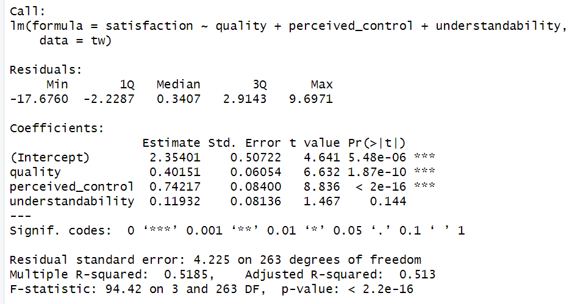
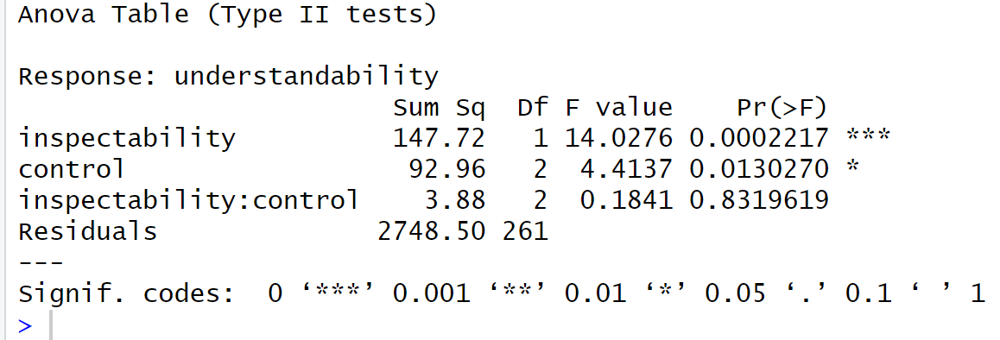
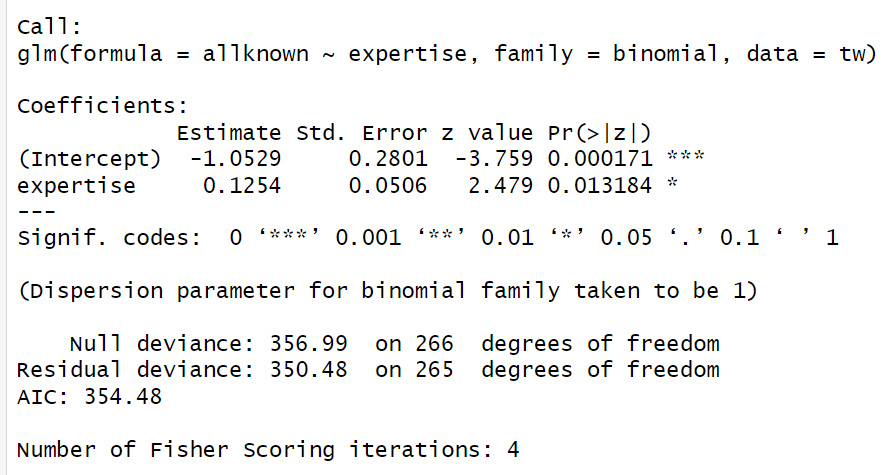
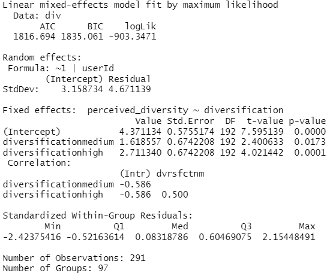

# Measurement and Evaluation in R

**Clemson University · HCC 6400 · Prof. Bart Knijnenburg · Spring 2024**

Four coursework assignments showing how I learned to evaluate human-centered computing systems with R. The collection progresses from describing data and fitting regression models to comparing experimental conditions, analyzing categorical outcomes and modeling repeated observations.

**[Portfolio overview](https://ralphugboko.dev/projects?discipline=school-projects&project=measurement-evaluation-r)** · **[Skills and interpretation guide](docs/skills-guide.md)** · **[Course syllabus](https://www.usabart.nl/eval/)**

## What I learned

- Choose an analysis that fits the research question, outcome type and study structure.
- Compare interface conditions and distinguish main effects from interactions.
- Interpret estimates, confidence intervals and effect sizes alongside p-values.
- Inspect regression assumptions and compare what additional model terms contribute.
- Account for repeated observations from the same participant.
- Explain model output in terms a design or engineering collaborator can use.

The [course learning and interpretation guide](docs/skills-guide.md) maps these skills to the four assignments and explains how I can apply them to user research and interface evaluation.

## Start with an assignment

| Assignment | Skills practiced | Read the assignment | R source |
| --- | --- | --- | --- |
| Homework 1 | Descriptive statistics, confidence intervals, correlation, multiple regression, model comparison and diagnostics | [Readable report](https://ralphugboko.dev/assets/coursework/measurement-evaluation/hw1/index.html) · [Original DOCX](original/reports/hw1.docx) | [hw1.R](original/scripts/hw1.R) |
| Homework 2 | Welch's t-test, effect sizes, robust comparisons, ANOVA, planned contrasts and interactions | [Readable report](https://ralphugboko.dev/assets/coursework/measurement-evaluation/hw2/index.html) · [Original DOCX](original/reports/hw2.docx) | [hw2.R](original/scripts/hw2.R) |
| Homework 3 | Logistic and quasi-Poisson regression, odds ratios, predicted probabilities, chi-square analysis and mosaic plots | [Readable report](https://ralphugboko.dev/assets/coursework/measurement-evaluation/hw3/index.html) · [Original DOCX](original/reports/hw3.docx) | [hw3.R](original/scripts/hw3.R) |
| Homework 4 | Repeated-measures and mixed ANOVA, random intercepts, mixed-effects models and a mediation exercise | [Readable report](https://ralphugboko.dev/assets/coursework/measurement-evaluation/hw4/index.html) · [Original DOCX](original/reports/hw4.docx) · [Original PDF](original/reports/hw4.pdf) | [hw4.R](original/scripts/hw4.R) |

The readable reports retain the original text, tables and **86 figure/output placements** from the submitted Word files. Images can be opened at full size. The reports and source scripts are coursework records; the skills guide provides concise explanations for portfolio readers.

## Selected R outputs

The images below were saved in the Spring 2024 reports and extracted without changing their contents.

### Homework 1: multiple regression

The model has an in-sample R-squared of 0.5185. This measures fit to the analyzed observations, not classification accuracy or held-out predictive performance.

### Homework 2: factorial ANOVA

The output separates two main effects from their interaction. The interaction p-value is approximately 0.832, so this analysis does not provide evidence of an interaction at the conventional 0.05 level.

### Homework 3: logistic regression

The expertise coefficient is 0.1254 on the log-odds scale. Exponentiating it gives an odds ratio of approximately 1.134 per unit of expertise. Odds ratios and changes in probability are different quantities.

### Homework 4: mixed-effects model

The saved output includes 291 observations grouped into 97 users. A participant-level random intercept accounts for repeated observations from the same person.

## Materials and context

- `original/reports/`: my original assignment write-ups.
- `original/scripts/`: the corresponding R working files, retained as submitted/archived.
- `reports/`: readable HTML exports with the original embedded outputs.
- `outputs/`: selected figures and statistical tables extracted from the reports.
- `data/`: the three supplied exercise datasets used by the assignments.
- `docs/skills-guide.md`: an explanation of the evaluation skills and how to read the results.
- `provenance.json`: source members and SHA-256 checksums.

The datasets were supplied for coursework. I analyzed them as assignments; I did not recruit the study participants or develop the recommender systems. The original scripts include local file paths and exploratory lines from the coursework environment. To run sections in RStudio, update the import paths to the matching files in `data/` and load the required packages. The displayed outputs come from the saved reports, rather than a new execution of the scripts.

The live syllabus currently describes a later course edition. This repository documents my **Spring 2024** coursework.
